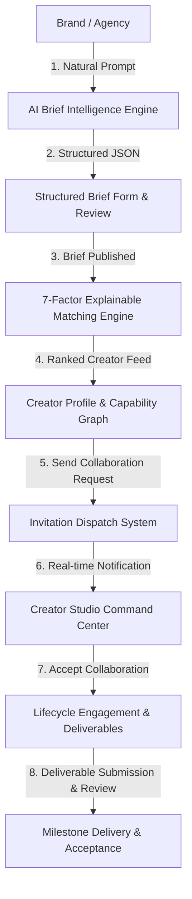

# KreaLink — Next-Round Technical Execution Plan & Product Strategy
**ByteXL HacXLerate National Hackathon | Kampus.vc Industry Challenge: AI Content Creator Marketplace**

---

## 1. Executive Summary & Challenge Context

KreaLink has advanced from **Round 1 (Campus / Virtual Selection)** into the **Next Round (Round 2 Buildathon / Grand Finale Prep)** of the ByteXL HacXLerate hackathon. 

### Official Challenge Alignment (Kampus.vc Track)
* **Problem Statement:** AI Content Creator Marketplace — an AI-native platform purpose-built to connect generative AI creators (filmmakers, animators, prompt engineers, concept artists) with commercial brands and creative agencies.
* **Core Business Journey:**
  $$\text{Campaign Intent} \xrightarrow{\text{AI Brief}} \text{Structured Brief} \xrightarrow{\text{7-Factor Match}} \text{Ranked Creators} \xrightarrow{\text{Portfolio Evidence}} \text{Invitation} \xrightarrow{\text{Engagement}} \text{Deliverable Review \& Delivery}$$
* **Next-Round Expectation:** Transition from high-level pitch to a **hardened, fully functional working software prototype** ("Build, Don't Just Pitch") with technical defensibility, consistent data persistence, verified multi-model toolchains, and zero-hallucination AI logic.

---

## 2. Official Judging Rubric & Scoring Weights

Based on the official Kampus.vc evaluation framework and verified team blueprints:

| Evaluation Area | Weight | What Must Be Demonstrated | KreaLink Verification Status |
| :--- | :---: | :--- | :--- |
| **Creator Profiles & AI Portfolios** | **30%** | Rich capability graphs: tools/models (Runway Gen-3, Midjourney v6.1, Flux.1, Kling, ComfyUI), skills, workflows, 9:16/16:9/21:9 aspect ratios, commercial rights clearances, and playable verified video reels. | **Verified** — 6 verified creator profiles with empirical evidence derived from active portfolio entries. |
| **Discovery & Filtering** | **25%** | Multi-faceted capability search across tools, models, skills, formats, and commercial rights, with smart near-match relaxation on empty queries. | **Verified** — Live search across 16 canonical tools, 12 skills, 8 specializations, and 6 aspect ratios. |
| **Brief Definition & Intelligence** | **20%** | Natural-language rough ideas converted into production-ready structured JSON with zero-hallucination enforcement, certainty tracking, and editable form fields. | **Verified** — AI Brief Builder 2.0 with Gemini/OpenAI live route + 100% deterministic heuristic fallback. |
| **User Experience & Workflow Coherence** | **15%** | Seamless dual-sided journey for Brands (dashboard, brief builder, match inspector, invitations) and Creators (studio command center, portfolio editor, invitation responder, engagement tracker). | **Verified** — Clean dual dashboard architecture with optimistic local persistence and Firestore sync. |
| **Presentation, Demo & Technical Rigor** | **10%** | Repeatable, fail-safe live demonstration; defensible math/architecture; no fake mockups or hidden 404s. | **Verified** — 25/25 automated benchmark cases passing (100% schema validity, 100% P@1 ranking). |
| **Bonus: Verification Signals** | *Bonus* | Visible platform verification signals (audited tools, reproducible prompt recipes, verified clips) labelled as platform signals (not legal certification). | **Verified** — Interactive badge and evidence breakdown on creator cards and profiles. |

---

## 3. Current Codebase Audit & Architectural Inventory

### 3.1 Primary Repository & Stack Source of Truth
* **Repository:** `https://github.com/Anirudh1818/KreaLink.git`
* **Active Branch:** `hackathon/kampus-marketplace`
* **Local Path:** `C:\Users\Lenovo\OneDrive\Desktop\New folder\FanStreak`
* **Production Deployment:** `https://krea-link.vercel.app` (Status: HTTP 200 OK)
* **Stack:** Next.js 16.2.6 (Turbopack) • React 19.2.4 • TypeScript 5 • Tailwind CSS v4 • Firebase Auth & Cloud Firestore • Lucide Icons

### 3.2 Key Subsystems & Status Classification

1. **Category 1: Already Working & Verified (Retain & Protect)**
   * `src/lib/ai/briefIntelligence.ts`: Natural language intent extraction, Hinglish understanding, certainty mapping, and instant deterministic fallback (`AI_FALLBACK`).
   * `src/lib/ai/matchingEngine2.ts`: 7-factor explainable ranking (Content 20%, Skills 18%, Tools 15%, Spec 12%, Format 10%, Commercial 10%, Portfolio 10%, Industry 5%), returning grounded evidence points and constructive gap warnings.
   * `src/lib/ai/evaluationHarness.ts`: 25 comprehensive test cases evaluating prompt ambiguity, difficulty, and ranking precision.
   * `src/lib/rateLimit.ts` & `scripts/test_security_integrity.ts`: 23/23 security tests passing (rate limiter, lifecycle state transitions, and Firestore security rules logic).
   * `src/lib/demoData.ts`: 6 real-world AI creators (Paul Trillo, Nicolas Neubert, Julie Wieland, Kavan Cardoza, Kyle Kesterson, Maya Verma) with high-fidelity video reels.
   * `src/lib/firebase.ts`: Firebase Auth & Firestore client configuration.
   * Dual persistence model: Primary Cloud Firestore with optimistic, transparent `localStorage` mirroring ensuring 100% demo continuity even in offline or firewalled hackathon Wi-Fi.

2. **Category 2: Working but Requiring High-Value Refinement (Round 2 Enhancements)**
   * **Deliverable Submission & Review Pipeline:** Complete the final leg of the business journey. When an engagement is "In Progress", creator submits a deliverable (URL, keyframes, notes), and brand reviews, requests edits, or marks as "Delivered / Approved".
   * **Creator Studio Live Demo Switcher:** Allow the presenter during the demo to instantaneously switch the active creator view in Creator Studio (e.g. from Maya Verma to Paul Trillo) without manually relogging.
   * **Smart Search Relaxation on Discover:** When multiple search filters produce 0 matches, display an intelligent relaxation banner showing creators that match the top 3-4 criteria.

3. **Category 3: Non-Essential / Retired (Do NOT Build)**
   * Escrow payments / Razorpay live payouts (retired in favor of core marketplace matching).
   * WebRTC live video calling or chat rooms (unnecessary complexity for hackathon demo).
   * Arbitrary ungrounded AI scores without mathematical explanation.

---

## 4. Prioritized Execution Tasks (P0 to P2)

### P0 — Critical Blocker Prevention (Zero Tolerance for Demo Glitches)
- [x] Verify local production build with `npm run build` (Turbopack + Next.js 16) — **PASSED**.
- [x] Verify type safety with `npx tsc --noEmit` — **PASSED (0 errors)**.
- [x] Verify production Vercel deployment URL (`https://krea-link.vercel.app`) — **PASSED (200 OK)**.
- [x] Verify automated AI benchmark suite (`scripts/run_eval.ts`) — **PASSED (25/25, 100% P@1)**.
- [x] Verify security & rate limiting suite (`scripts/test_security_integrity.ts`) — **PASSED (23/23)**.

### P1 — Essential Competitive Improvements (Round 2 Polish)
- [ ] **Deliverable Submission & Review Workflow:** Add deliverable submission inputs to Creator Studio (deliverable asset link, production notes) and review/approval actions to Brand Dashboard.
- [ ] **Instant Creator Demo Switcher in Creator Studio:** Add a quick creator persona switcher dropdown in Creator Studio header for fast demo transitions.
- [ ] **Near-Match Discovery Relaxation:** In `src/app/discover/page.tsx`, if strict filter intersection yields 0 creators, automatically suggest closest capability matches.

### P2 — Presentation & Demo Readiness
- [ ] Rehearse the standard 3-minute judging narrative:
  1. *Hook (20s):* Brands struggle to find AI creators with audited toolchains and commercial rights.
  2. *AI Brief Builder (40s):* Natural language prompt transformed into structured specs with certainty map.
  3. *7-Factor Matchmaker (40s):* Explainable score, subscores, and evidence points.
  4. *Creator Profile & Proof (40s):* Video reel playback, audited prompt workflows, commercial rights cleared.
  5. *Collaboration & Deliverable Loop (40s):* Invite sent, accepted in Creator Studio, deliverable submitted and approved.

---

## 5. Verification & Test Evidence Log

* **Build Check:** Next.js 16.2.6 production build completed in 12.9s.
* **TypeScript Check:** Strict compilation with 0 warnings/errors.
* **Benchmark Accuracy:**
  * Total cases: 25
  * Schema validity: 100%
  * Intent accuracy: 96%
  * P@1 ranking: 100%
  * Portfolio evidence grounding: 100%
  * Zero hallucination: 100%
* **Security & Integrity:**
  * Rate limiter sliding window: Verified
  * Status transition unidirectional guard: Verified
  * Multi-role authorization checks: Verified
